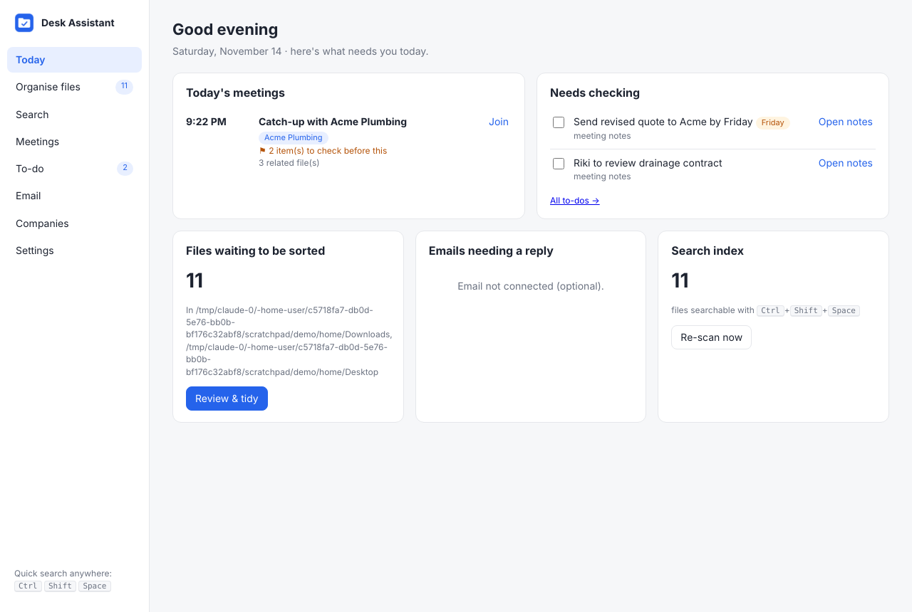
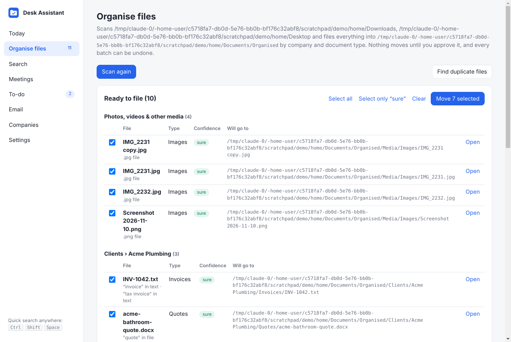

# Desk Assistant

A personal assistant that runs on your computer and helps keep it tidy. It:

- **Sorts files by company and document type.** It watches Downloads, Desktop and any synced phone folder, reads what's inside each file (PDF, Word, text, email), and files it like this:
  `Documents/Organised/Clients/Acme Plumbing/Invoices/INV-1042.pdf`
  Photos, videos, installers and zip files are sorted into `Organised/Media/...`. Nothing moves until you approve it, and you can undo any batch.
- **Checks your meetings.** It reads Google, Outlook or Apple calendars through their private iCal link. It reminds you before each meeting, pulls out agenda items marked `[ ]`, `Action:` or `TODO:`, and shows recent files for any company the meeting mentions.
- **Keeps a to-do list** from meeting agendas, meeting notes and emails, plus anything you add yourself.
- **Searches instantly.** Press **Ctrl+Shift+Space** (⌘+Shift+Space on a Mac) anywhere to open a search box. It searches file names, companies and the text inside documents.
- **Finds duplicate files** so you can free up space.
- **Sorts email (optional).** It connects to any IMAP mailbox and groups mail into *Needs reply*, *Invoices & Bills*, *Receipts*, *Meetings* and *Newsletters*. It can save invoice attachments straight into the right company folder. It is read-only: it never deletes or moves mail.
- **Uses AI only if you choose to (optional).** Add an Anthropic API key and Claude will look at files the built-in rules aren't sure about. Without a key, everything stays on your computer.

The app runs in the system tray, so closing the window doesn't stop it.




## Run it

You need [Node.js](https://nodejs.org) 20 or newer.

```bash
npm install
npm start
```

## Build an installer

```bash
npm run dist:win     # Windows .exe installer (build on Windows)
npm run dist:mac     # macOS .dmg (build on a Mac)
npm run dist:linux   # Linux AppImage
```

The finished installer is in `dist/`.

## First-time setup (about 2 minutes)

1. **Companies:** enter your own business name, so your own invoices aren't filed under you. Then add the companies you deal with and their type (Client, Supplier, Utilities...). Add other spellings as aliases, e.g. `ACME`, `acmeplumbing`.
2. **Settings → Calendars:** paste your calendar's secret iCal address.
   - Google: Calendar settings → *Integrate calendar* → *Secret address in iCal format*
   - Outlook: Settings → Calendar → Shared calendars → *Publish a calendar* → ICS link
3. **Phone:** turn on camera/scan upload in OneDrive, Google Drive or iCloud. Then add that synced folder under *Settings → Folders to tidy*.
4. **Email (optional):** add your IMAP server and an *app password*. Gmail, Outlook and iCloud all let you create one in account security settings.

## How sorting decides

1. **Document type:** keywords in the file name and text, e.g. "tax invoice", "amount due", "agreement", "payslip".
2. **Company:** checked in this order: your company list (including aliases), then "Bill to / Client / From:" lines, then names ending in Ltd/Inc/LLC/GmbH..., then the business email domain.
3. **Confidence:**
   - *Sure* and *likely* files are offered for moving.
   - *Unsure* files go to **Needs your help**, so you can add the company and scan again.
   - Auto-tidy (off by default) only moves *sure* files.

## Project layout

```
src/main.js          app window, tray, shortcut, reminders, background jobs
src/core/            the logic (no UI), covered by tests
  classifier.js      works out document type and company
  organizer.js       plans and applies moves, undo, duplicates
  indexer.js         search index
  calendar.js        iCal reading, including repeating meetings
  actions.js         finds to-do items in text
  email.js           IMAP sorting
  ai.js              optional Claude classification
src/renderer/        the screens (plain HTML/CSS/JS)
test/                npm test
```

Your data (settings, index, to-dos, undo history) is stored in the app's own data folder. The email password and API key are encrypted with the operating system's keychain.
